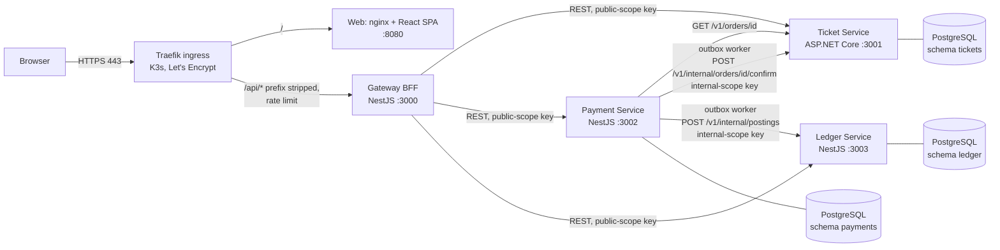

# E-Ticketing & Payment Simulation Platform

[](https://github.com/zainelabdeen/e-ticketing/actions/workflows/ci.yml)
[](https://github.com/zainelabdeen/e-ticketing/actions/workflows/images.yml)

A small fintech-style platform that sells event tickets (Gold, Premium, VIP), simulates card and QR payments, and
records every successful payment as a **double-entry ledger** entry. A backoffice shows transactions, ledger entries,
account balances and ticket availability. It is four services behind one gateway (an ASP.NET Core Ticket Service and
NestJS Payment, Ledger and Gateway services), one PostgreSQL instance with a schema per service, and a React SPA. It
runs with one command locally (Docker Compose) and deploys to a single-node K3s VM behind Traefik with Let's Encrypt.

**Live demo:** <https://eticket-zain.duckdns.org/> (backoffice at `/backoffice`). The demo VM is temporary and may be
stopped or deleted after the review period; if it is gone, run the project locally with [docs/local-demo.md](docs/local-demo.md).

Requirements: [docs/challenge.md](docs/challenge.md). Full design: [docs/spec.md](docs/spec.md). Decisions and rejected
alternatives: [docs/adr/](docs/adr/) (index in spec section 13).

## Architecture



One PostgreSQL instance; one schema, one owner role (migrations) and one runtime role (DML only) per service; no
cross-schema foreign keys, services only talk REST ([ADR-0003](docs/adr/0003-one-postgres-schema-per-service.md)).
Locally nginx plays Traefik's part (`/api` to the gateway).

## Services

| Service                                                                                                    | Owns                                                                                                                                    | Never does                                                                     |
| ---------------------------------------------------------------------------------------------------------- | --------------------------------------------------------------------------------------------------------------------------------------- | ------------------------------------------------------------------------------ |
| **Gateway** (NestJS BFF, `apps/gateway`)                                                                   | Public edge: CORS, per-IP rate limits, backoffice login and JWT checks, correlation IDs, API-key custody, 1:1 proxying                  | Business logic, DB access, holding internal-scope keys                         |
| **Ticket Service** (ASP.NET Core, `apps/ticket-service-dotnet`; NestJS reference in `apps/ticket-service`) | Ticket types, quota, orders, atomic reservation (one conditional `UPDATE`), 15-minute expiry job, order confirmation                    | Payments, money movement                                                       |
| **Payment Service** (NestJS, `apps/payment-service`)                                                       | Payment methods (Strategy + registry: `CardHandler`, `QrHandler`), idempotency, one live payment per order, transactions, outbox worker | Pricing (the amount is read from the Ticket Service), choosing ledger accounts |
| **Ledger Service** (NestJS, `apps/ledger-service`)                                                         | Chart of accounts, posting templates, double-entry append-only journal, balances                                                        | Knowing about tickets or payment methods                                       |
| **Web** (React + Vite, `apps/web`)                                                                         | Ticket selection, checkout, receipt, backoffice UI                                                                                      | Holding API keys, computing prices                                             |

Shared code: `packages/nest-common` (Nest plumbing), `packages/contracts` (OpenAPI per service plus generated types; the
contract is the source of truth, [ADR-0013](docs/adr/0013-contract-first-openapi.md)).

### The money flow in five steps

1. `POST /v1/orders` reserves quota atomically and returns a `PENDING` order; the server computes the total.
2. `POST /v1/payments` (needs `Idempotency-Key`) reads the amount from the Ticket Service. A valid card succeeds at once;
   QR returns `PENDING` plus a payload and the server flips it to success after 8 seconds (the SPA polls).
3. On success, **one DB transaction** writes the payment status, a `transactions` row (transaction ID, payment reference
   `PAY-yyyymmdd-XXXXXX`, timestamp) and an `outbox_events` row ([ADR-0006](docs/adr/0006-transactional-outbox.md)).
4. The outbox worker confirms the order in the Ticket Service, then posts to the Ledger. Both calls are idempotent and retried.
5. The Ledger writes a balanced entry: debit `1100 Payment Gateway Clearing`, credit `4000 Ticket Sales Revenue`
   (`UNIQUE(transaction_id)`, append-only, [ADR-0009](docs/adr/0009-double-entry-append-only-ledger.md)). A paid order
   that can no longer be confirmed is posted to `2100 Customer Refunds Payable` instead, so revenue is never booked for an unfulfilled order.

Schema (tables, constraints, indexes): [spec section 3](docs/spec.md#3-data-model).

## Run locally

Needs Docker with Compose v2, Node 26 and pnpm 10.34.9. Details, ports, test cards and seed data: **[docs/local-demo.md](docs/local-demo.md)**.

```bash
pnpm install
node infra/scripts/setup-local.mjs                         # writes infra/.env, prints the admin login once
docker compose -f infra/docker-compose.yml up -d --build --wait
infra/scripts/seed-demo.sh                                 # optional: real purchases for the backoffice
```

Then open `http://127.0.0.1:8080` (shop) and `http://127.0.0.1:8080/backoffice`. The gateway API is on `http://127.0.0.1:3000`
(Swagger at `/docs`). If a port was busy the setup script picked another; see `docs/local-demo.md`.

Checks: `pnpm lint`, `pnpm format:check`, `pnpm build`, `pnpm test`, `pnpm test:int` (Docker).

## Deploy (K3s on one VM)

Kustomize manifests in `infra/k8s`, Traefik ingress with Let's Encrypt, images from GHCR, opt-in CD. Step by step
(Oracle or Google Cloud VM, DNS, K3s, secrets, first deploy, CD, backups, troubleshooting):
**[infra/k8s/README.md](infra/k8s/README.md)**. How the live demo was deployed on Google Cloud, with the problems hit and their fixes: [docs/deployment-gcp.md](docs/deployment-gcp.md). Rationale: [ADR-0011](docs/adr/0011-deployment-k3s-single-vm.md), [ADR-0026](docs/adr/0026-k3s-manifests-and-deploy.md).

## Environment variables

No secret is committed: only `.env.example` files, and `infra/scripts/setup-local.mjs` generates real values into
git-ignored files. Full table: [spec section 7.1](docs/spec.md#71-environment-variables). Examples:
[`infra/.env.example`](infra/.env.example) (compose), [`apps/gateway`](apps/gateway/.env.example), [`apps/ticket-service`](apps/ticket-service/.env.example),
[`apps/payment-service`](apps/payment-service/.env.example), [`apps/ledger-service`](apps/ledger-service/.env.example), [`apps/web`](apps/web/.env.example).

| Variable                                                          | Used by                                     | Purpose                                                                                      |
| ----------------------------------------------------------------- | ------------------------------------------- | -------------------------------------------------------------------------------------------- |
| `DATABASE_URL`, `MIGRATION_DATABASE_URL`                          | ticket, payment, ledger                     | Runtime role / owner role connection, `?schema=<name>`                                       |
| `PUBLIC_API_KEY_TICKET` / `_PAYMENT` / `_LEDGER`                  | gateway sends, each service accepts its own | Public-scope service keys                                                                    |
| `INTERNAL_API_KEY_TICKET` / `_LEDGER`                             | payment sends, ticket and ledger accept     | Internal-scope keys (confirm order, post to ledger); the gateway never has them              |
| `JWT_SECRET`, `ADMIN_EMAIL`, `ADMIN_PASSWORD_HASH_B64`            | gateway                                     | Backoffice login (HS256, 1 h; base64 of a bcrypt hash)                                       |
| `TICKET_SERVICE_URL`, `PAYMENT_SERVICE_URL`, `LEDGER_SERVICE_URL` | gateway, payment                            | Downstream base URLs                                                                         |
| `WEB_ORIGIN`, `TRUST_PROXY`, `RATE_LIMIT_*_PER_MIN`               | gateway                                     | CORS origin, trusted proxy hops, per-IP limits (100 default, 5 orders, 10 logins per minute) |
| `ORDER_TTL_MINUTES` (15), `QR_SUCCESS_DELAY_SECONDS` (8)          | ticket, payment                             | Business timings                                                                             |
| `SWAGGER_ENABLED`, `LOG_LEVEL`, `PORT`                            | all services                                | Docs, log level, listen port                                                                 |
| `VITE_API_BASE_URL`                                               | web (build time)                            | Gateway URL, default `/api`                                                                  |

## API examples

All calls go through the gateway, the only public API (`GW=http://127.0.0.1:3000` locally; behind Traefik use
`https://<host>/api`). The contract is [`packages/contracts/openapi/gateway.yaml`](packages/contracts/openapi/gateway.yaml);
the shapes come from the service contracts next to it. Errors share one envelope with a `code`. Needs `jq` for the ID extraction.

```bash
GW=http://127.0.0.1:3000

# 1. Ticket types with live availability
curl -s $GW/v1/ticket-types

# 2. Create an order (server computes the total and reserves quota; 5 per minute per IP)
ORDER=$(curl -s -X POST $GW/v1/orders -H 'content-type: application/json' \
  -d '{"items":[{"ticketTypeCode":"GOLD","quantity":2},{"ticketTypeCode":"VIP","quantity":1}]}' | jq -r .id)

# 3. Pay by card. Idempotency-Key is required (8-128 chars); repeat the call with the same key and
#    body and you get the stored response plus "Idempotent-Replayed: true", not a second payment.
curl -s -i -X POST $GW/v1/payments -H 'content-type: application/json' \
  -H "Idempotency-Key: $(uuidgen)" \
  -d "{\"orderId\":\"$ORDER\",\"method\":\"CARD\",\"card\":{\"number\":\"4242424242424242\",\"expMonth\":12,\"expYear\":2030,\"cvc\":\"123\",\"holder\":\"Jane Doe\"}}"
```

QR payment (use a new order; it is a different payment): the response is `PENDING` with a `qrPayload`; poll until `SUCCEEDED` (about 8 s).

```bash
ORDER=$(curl -s -X POST $GW/v1/orders -H 'content-type: application/json' \
  -d '{"items":[{"ticketTypeCode":"GOLD","quantity":1}]}' | jq -r .id)
PAY=$(curl -s -X POST $GW/v1/payments -H 'content-type: application/json' \
  -H "Idempotency-Key: $(uuidgen)" -d "{\"orderId\":\"$ORDER\",\"method\":\"QR\"}" | jq -r .id)
until [ "$(curl -s $GW/v1/payments/$PAY | jq -r .status)" = SUCCEEDED ]; do sleep 1; done
curl -s $GW/v1/payments/$PAY            # status SUCCEEDED, transaction {transactionId, paymentReference, createdAt}
```

Backoffice (JWT, one hour). Use the email and password printed by `setup-local.mjs`:

```bash
TOKEN=$(curl -s -X POST $GW/v1/auth/login -H 'content-type: application/json' \
  -d '{"email":"admin@eticket.local","password":"<admin password>"}' | jq -r .accessToken)
curl -s -H "Authorization: Bearer $TOKEN" "$GW/v1/backoffice/transactions?page=1&pageSize=20"
curl -s -H "Authorization: Bearer $TOKEN" "$GW/v1/backoffice/ledger-entries?page=1&pageSize=20"
curl -s -H "Authorization: Bearer $TOKEN" $GW/v1/backoffice/accounts              # balances; debits equal credits
curl -s -H "Authorization: Bearer $TOKEN" $GW/v1/backoffice/ticket-availability
```

Other routes: `GET /v1/orders/{orderId}`, `POST /v1/payments/{paymentId}/cancel` (switch method), `GET /health/live`, `GET /health/ready`.
Test cards: `4242 4242 4242 4242` (success), `4242 4242 4242 4241` (fails the Luhn check, 422).

## 5-minute demo script

Needs the stack running ([Run locally](#run-locally)); the longer, requirement-by-requirement version is in [docs/local-demo.md](docs/local-demo.md#demo-script).

1. **Buy** (1 min). Open the shop, pick Gold x2 and VIP x1; the total updates (the server recomputes it). Continue: an order is created and quota reserved, with a 15-minute countdown.
2. **Card** (30 s). Pay with `4242 4242 4242 4242`, expiry `12/30`, CVC `123`. The receipt shows transaction ID, payment reference and timestamp. Try `...4241` first for the inline error.
3. **QR** (1 min). Buy again, choose QR scan. The page waits, polls once a second, and moves to the receipt after about 8 seconds, with no scanning.
4. **Backoffice** (1 min). Open `/backoffice`, log in. Transactions lists both purchases. Ledger entries shows each one as two lines: debit 1100 Payment Gateway Clearing, credit 4000 Ticket Sales Revenue, equal amounts.
5. **Balances and availability** (1 min). Account balances shows total debit equal to total credit ("Balanced"). Ticket availability shows Available dropped by what you bought (quota 100, sold plus reserved never above it).
6. **Idempotency** (30 s, optional). Send the same payment twice with one `Idempotency-Key` (curl above): same payment ID, second response has `Idempotent-Replayed: true`.

## CI/CD

GitHub Actions ([ADR-0025](docs/adr/0025-ci-pipeline-and-coverage.md), [ADR-0026](docs/adr/0026-k3s-manifests-and-deploy.md)):

| Workflow     | What it does                                                                                                                                                                                                                                                                                                                                                        |
| ------------ | ------------------------------------------------------------------------------------------------------------------------------------------------------------------------------------------------------------------------------------------------------------------------------------------------------------------------------------------------------------------- |
| `ci.yml`     | `verify` (lint, format, build, k8s manifests via kubeconform and script tests), `test` and `test-int` (unit and Testcontainers, opt-in coverage), `e2e` (compose smoke and contract suites), `k3d` (real K3s in CI: deploy the manifests, smoke, gateway contract suite, redeploy, redirect and rate-limit checks), `sonar` (SonarCloud, skipped without the token) |
| `images.yml` | Builds only changed images (amd64 and arm64, native runners); `main` pushes to GHCR and re-tags unchanged images so every commit has a full `sha-<7>` set                                                                                                                                                                                                           |
| `deploy.yml` | Opt-in CD: after `Images` succeeds on a push to `main`, SSH to the VM and run `infra/k8s/scripts/deploy.sh`. Skipped (green) without the `DEPLOY_*` secrets; protected `production` environment                                                                                                                                                                     |

Branch flow: feature or phase branch, PR to `dev`, release PR `dev` to `main`; only `main` publishes images.

## Assumptions and trade-offs

- **Simulation, not PCI.** The card number is validated (Luhn, expiry), used once and never stored or logged; only the last four digits are kept. Success applies to every valid payment; invalid input gets a 422 and creates nothing. QR is a simulation payload, not real UPI or QRIS.
- **Money** is integer minor units plus a currency column (AED); no floats ([ADR-0007](docs/adr/0007-money-integer-minor-units.md)).
- **Revenue is recognized on order confirmation**, not on payment. A paid order that can no longer be confirmed (expired and sold out) goes to Refunds Payable; the refund itself is manual and out of scope.
- **Outbox, not a broker.** At-least-once delivery with idempotent consumers; a failed event is replayed with a runbook SQL (spec section 4.4). A crash between the Ledger's reply and the outbox commit can lose the confirm outcome: documented, accepted ([ADR-0006](docs/adr/0006-transactional-outbox.md)).
- **Auth.** Scoped static API keys between services (the gateway cannot confirm orders or post to the ledger); one backoffice admin from env, JWT valid one hour, not revocable ([ADR-0010](docs/adr/0010-auth-and-pci-scope.md)).
- **Guest checkout** means anonymous clients can hoard reservations; mitigated by per-IP limits (5 orders per minute), at most 10 per item and a 15-minute expiry.
- **Single node, one replica per workload.** No HA; scheduled jobs (expiry, QR flip, outbox) assume one replica and are safe but wasteful with two. Postgres is a StatefulSet on local-path storage with a daily dump on the same disk; managed Postgres is out of scope. There are no NetworkPolicies: every Service is `ClusterIP` and only Traefik is exposed.
- **Postgres bootstrap and migrations** run as initdb and an initContainer, not Jobs (ADR-0026); a password rotation therefore needs a manual role change in psql (documented in the deploy guide).
- **Language split.** The challenge mandates .NET for one core service: the Ticket Service was built in NestJS first and ported to ASP.NET Core against the same contract, with the contract suite as the parity gate ([ADR-0002](docs/adr/0002-nestjs-first-dotnet-port.md), [ADR-0021](docs/adr/0021-ticket-service-dotnet-port.md)).
- **SQL-first migrations** (Prisma only applies them) so CHECK constraints, partial unique indexes and grants are explicit ([ADR-0015](docs/adr/0015-sql-first-migrations.md)).
- Risk table: [spec section 10](docs/spec.md#10-risks-and-limitations). Requirement traceability: [spec section 11](docs/spec.md#11-requirement-traceability).
